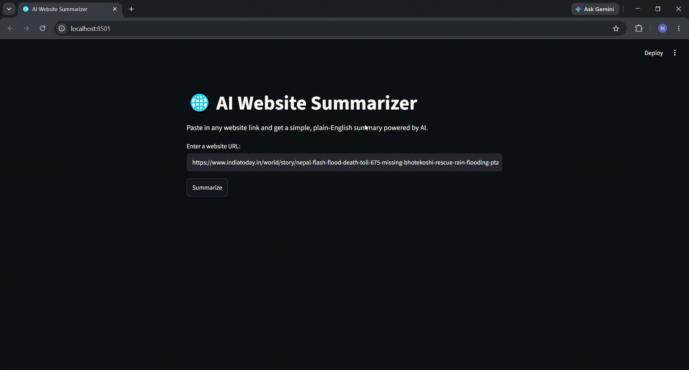

# 🌐 AI Website Summarizer

A small tool that reads any website and gives you a short, plain-English summary using OpenAI's GPT model.

I built this while learning how to work with LLM APIs — specifically how to scrape web content, structure prompts, and turn raw text into something genuinely useful.

## What it does

- Takes any website URL as input
- Scrapes the visible text content from the page
- Sends it to GPT-4.1-mini with a custom prompt (styled as a friendly "English professor" explaining things simply)
- Returns a short, easy-to-understand summary — including any news/announcements if the site has them

## Demo

  

## How it works

There are two ways to run this project:

**1. Jupyter Notebook** (`Summarizing_websites_using_AI.ipynb`)
Run the notebook cell by cell to see the summarizer in action, including test examples on Wikipedia, CNN, and Anthropic's website.

**2. Streamlit Web App** (`app.py`)
A simple browser-based interface — type in a URL, click a button, and see the summary appear.

```bash
streamlit run app.py
```

## Setup

1. Clone this repository
2. Install the dependencies:
   ```bash
   pip install -r requirements.txt
   ```
3. Create a `.env` file in the project folder with your OpenAI API key:
   ```
   OPENAI_API_KEY=your_key_here
   ```
4. Run either the notebook or the Streamlit app (see above)

## Files

| File | Purpose |
|------|---------|
| `Summarizing_websites_using_AI.ipynb` | Main notebook with step-by-step code and examples |
| `scraper.py` | Handles fetching and cleaning website content |
| `app.py` | Streamlit web app version |
| `requirements.txt` | Python packages needed to run this project |

## What I learned

- How to scrape and clean website content using BeautifulSoup
- How system prompts and user prompts shape an AI model's output
- How small wording changes in a prompt can noticeably change the tone of a response
- How to wrap a working script into a simple web app using Streamlit

## What's next

- Add support for summarizing PDFs and longer documents
- Handle websites that block scraping or load content dynamically with JavaScript
- Deploy the Streamlit app so anyone can try it live

---

*This is a learning project — feedback and suggestions are very welcome!*
