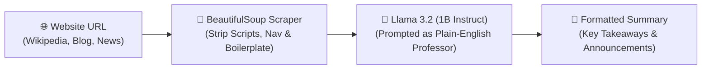

# 🌐 AI Website Summarizer

A practical AI-powered web tool that reads any website and provides an instant, plain-English summary using **Meta's open-source Llama 3.2 (1B Instruct)**.

**100% free and open-source — zero paid OpenAI API keys or subscriptions required!**

[](https://colab.research.google.com/github/mitadrudeb/ai-website-summarizer/blob/main/Summarizing_websites_using_AI.ipynb)

-purple?logo=meta)


---

## ✨ Features

- **🦙 Open-Source LLM:** Powered by **Meta Llama 3.2 (1B Instruct)** running via Hugging Face `transformers`.
- **💸 Zero API Cost:** No OpenAI credit card requirements; runs entirely on consumer CPUs, CUDA GPUs, or free cloud environments.
- **🧹 Clean Web Scraping:** Extracts page content via `BeautifulSoup` while automatically stripping boilerplate scripts, navbars, and ads.
- **🎓 Professor Persona:** Custom system prompting instructs the LLM to explain concepts in clear, everyday English and highlight any key news/updates.
- **🖥️ Dual Interfaces:** Run via an interactive **Streamlit Web App** or step-by-step in a **Jupyter Notebook**.

---

## 📸 Demo


---

## ⚙️ Architecture & Pipeline



---

## 🚀 Quick Start

### Option 1: Run in Google Colab (1-Click Cloud Execution)

Click the badge below to run the complete notebook in Google Colab:

[](https://colab.research.google.com/github/mitadrudeb/ai-website-summarizer/blob/main/Summarizing_websites_using_AI.ipynb)

### Option 2: Run Locally

```bash
# 1. Clone the repository
git clone https://github.com/mitadrudeb/ai-website-summarizer.git
cd ai-website-summarizer

# 2. Create and activate a virtual environment
python -m venv venv
source venv/bin/activate       # Linux / macOS
# venv\Scripts\activate         # Windows

# 3. Install open-source dependencies
pip install -r requirements.txt

# 4. Launch the Streamlit Web Application
streamlit run app.py
```

The app will open automatically in your browser at `http://localhost:8501`.

---

## 📂 Project Structure

```
ai-website-summarizer/
├── app.py                               # Interactive Streamlit Web UI
├── scraper.py                           # Clean HTML text extractor
├── Summarizing_websites_using_AI.ipynb  # Step-by-step Jupyter Notebook
├── requirements.txt                     # Open-source dependencies (no OpenAI needed)
├── demo.gif                             # UI demo animation
├── README.md                            # Documentation
└── .gitignore                           # Git ignore rules
```

---

## 💡 What I Learned

1. **Open-Source LLMs vs. Proprietary APIs:** Transitioning from closed APIs (like OpenAI GPT-4) to open-source models (like Llama 3.2 1B) eliminates per-token API costs, removes third-party privacy risks, and allows completely offline inference.
2. **Instruction Following at 1B Scale:** Compact 1B parameter models perform remarkably well on constrained summarization tasks when steered by conversational chat templates (`system` + `user`).
3. **Data Preprocessing:** Scraping unstructured web HTML requires robust sanitization (`soup.decompose()`) so the LLM context window isn't polluted by noisy UI code.
4. **Streamlit Resource Caching:** Using `@st.cache_resource` ensures large transformer weights are held in memory once rather than re-downloaded or reloaded on every user button click.

---

## 📄 License

This project is licensed under the **MIT License**.
